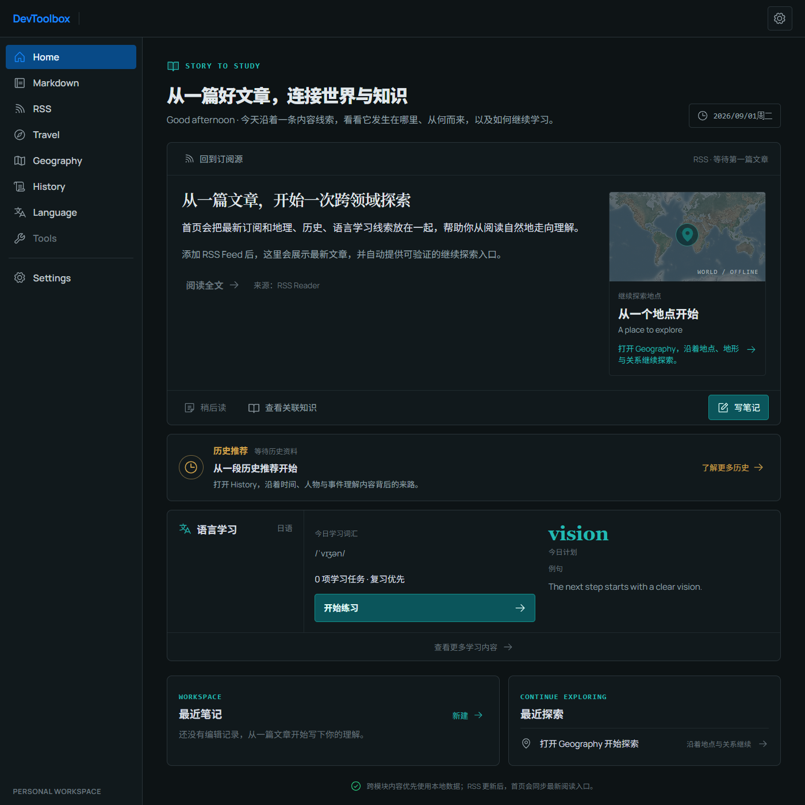
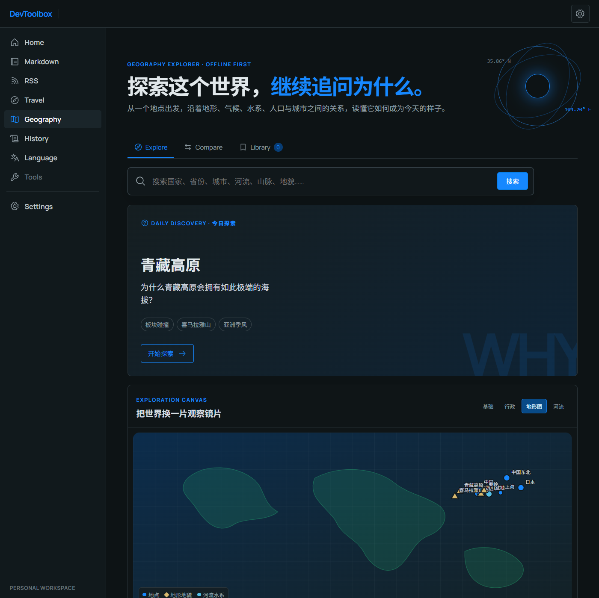
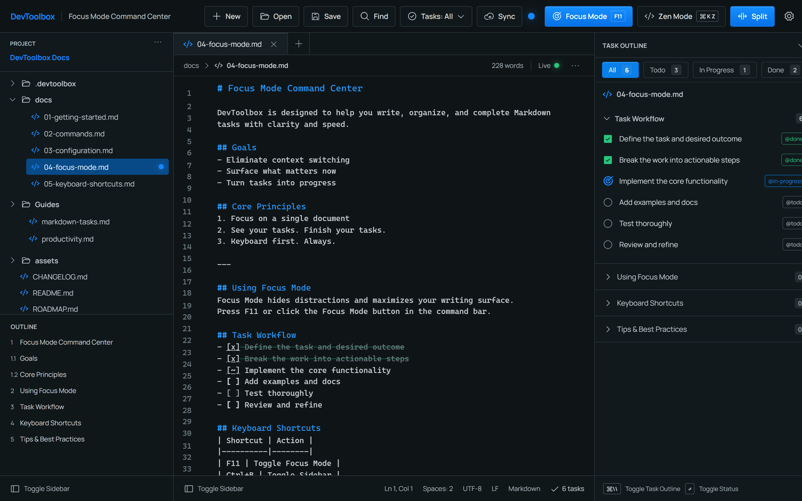
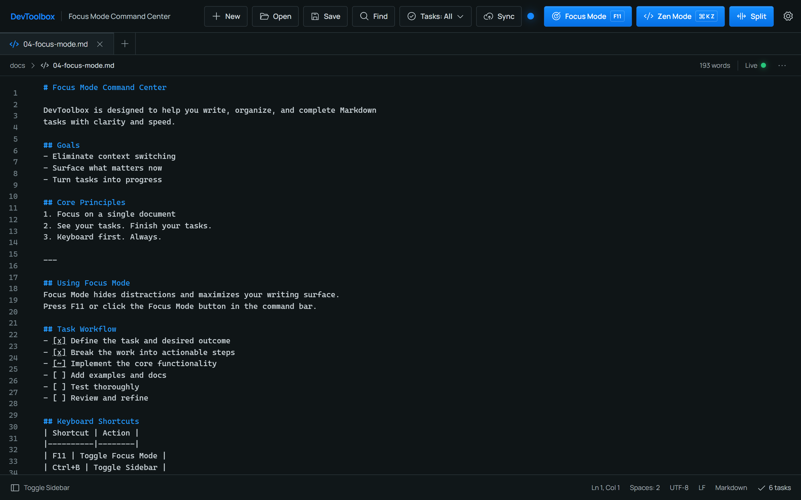
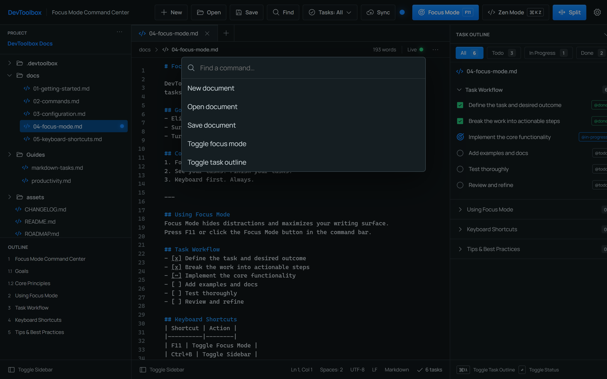

# DevToolbox

DevToolbox 是一款以本地数据为基础的个人知识工作台。它把 AI 对话、文件与文档、订阅阅读、历史与地理探索、语言学习和学习白板放在同一个桌面与移动端界面中，帮助个人资料持续积累并可再次检索。



## 功能

| 模块 | 能做什么 |
| --- | --- |
| **Home 与 AI** | 从首页发起提问；AI 可结合当前页面上下文调用已注册的知识工具。对话可持久化。 |
| **Knowledge** | 管理个人记忆、文档和授权目录内的文件，并检索相关内容。记忆写入需要用户确认。 |
| **News 与 RSS** | 浏览新闻和订阅源，查看条目、搜索内容并刷新订阅。 |
| **History** | 浏览中国历史时期、事件、人物与作品；可使用补充资料功能。历史主库由独立数据管线生成，应用只读消费。 |
| **Geography 与 Travel** | 探索地理实体、地形和地图，研究目的地并查看行程预览。地图、搜索、天气、POI 与 AI 能力视配置而定。 |
| **Language** | 学习英语、日语、普通话和粤语，使用词汇库、听说练习与间隔复习。可选数据包和数据来源见[语言数据说明](docs/language/DATA_SOURCES.md)。 |
| **Study Board** | 创建学习白板，绘制、撤销/重做并保存快照。 |
| **Search、Server 与 Settings** | 全局搜索、查看家庭服务器状态与日志、配置应用和服务。涉及系统修改的操作需要确认。 |

桌面应用基于 Tauri 2；前端也包含 PWA 资源和适配手机、平板的界面。AI 模型、语音识别、外部搜索、地图及远程身份服务需要自行配置；不配置时相应功能会受限，其他本地功能仍可使用。远程 MCP 默认关闭。



## 开始使用

### 环境

项目工具链由 [mise](https://mise.jdx.dev) 统一管理：

- Node.js 24（见 `mise.toml`，与 CI 一致）
- Rust 1.95.0（固定版本，见 `rust-toolchain.toml`；mise 直接读取）
- 桌面构建所需的 Tauri 平台依赖；Windows 使用 MSVC 工具链（`cl.exe` + Windows SDK）

安装 mise 后，在仓库根目录执行：

```bash
mise trust && mise install
```

`mise install` 会按 `mise.toml`、`rust-toolchain.toml` 与 `mise.lock` 安装（或校验）工具链。不使用 mise 时，可以自行准备 Rust 1.95.0（或更高）与 Node.js 20+。

### 拉取代码：submodule 与 History 数据（否则 History 不可用、5 个测试会红）

`history-data-pipeline` 是 submodule，它的产物 `dist/history.duckdb` **不随 Git 分发**。
克隆时带 `--recursive`，或者在任何一次 `git pull` 之后补两步：

```bash
git submodule update --init --recursive   # 同步 submodule 代码
mise run data                             # 重建 dist/history.duckdb（uv 会自动装管线依赖）
```

不做这一步的表现：桌面端 History 降级为「数据未生成」卡片，`cargo test --workspace` 里
`history::duckdb::semantic_tests::*` 会因为缺列/缺知识条目失败。

### 启动桌面应用

```bash
git clone --recursive https://github.com/wuhanwoaini521/self-tools.git
cd self-tools

# 安装前端依赖（mise run dev 会自动执行）
mise run install

# 启动 Tauri 桌面应用
mise run dev
```

`mise tasks ls` 可查看全部任务；不经过 mise 的等价命令是 `npm --prefix apps/desktop/ui install` 和 `npm --prefix apps/desktop/ui exec -- tauri dev`。安装 GNU Make 后也可以运行 `make install` / `make dev`（Make 目标转发到对应的 mise task）。

仅启动 Vite 前端预览（不启动 Rust/Tauri 后端）：

```bash
mise run dev-web
# 或 npm --prefix apps/desktop/ui run dev / make dev-web
```

浏览器预览用于查看界面；依赖桌面桥接、本地文件或 SQLite 的功能需要在 Tauri 应用中体验。

### 浏览器 / PWA 方式打开

同时启动本地数据服务（`127.0.0.1:8080`）与网页前端（`127.0.0.1:1420`），网页端通过 `/api` 代理读写同一份 `config/` 数据：

```bash
mise run web        # 或 make web；Ctrl+C 停止全部
```

macOS 上也可以直接双击 `scripts/open-self-tools-web.command`（会额外打开浏览器）。页面就绪后在 Chrome/Edge 点地址栏右侧「安装」图标，或用 Safari 的 文件 → 添加到程序坞，即可得到独立窗口的桌面图标。

Windows 上 `scripts/self-tools-web.sh` 依赖 `lsof` / `ipconfig getifaddr` / `open`（macOS 专属），请直接用两个终端分别启动：

```powershell
target\debug\devtoolbox-server.exe          # 数据服务 127.0.0.1:8080（首次先 cargo build -p devtoolbox-server）
npm --prefix apps/desktop/ui run dev        # 网页端 127.0.0.1:1420
```

两者默认都指向仓库内 `config/`（与桌面端 dev 模式同一份数据）。若想换目录，服务端用 `--data-dir` 或 `SELF_TOOLS_DATA_DIR`，桌面端用 `SELF_TOOLS_HOME`。

同一 Wi-Fi 下的手机 / 平板 / 另一台电脑访问：

```bash
mise run web-lan    # 或 make web-lan；等价于 bash scripts/self-tools-web.sh --lan
```

启动后会多打印一行本机局域网地址（例如 `http://192.168.1.23:1420`），在手机浏览器里打开即可。数据服务（8080）仍只监听 `127.0.0.1`，请求经 Vite 同源代理转发，**不会**把数据服务暴露到局域网。

> 说明：HTTP 的局域网地址不是安全上下文，浏览器不会注册 Service Worker，所以在手机上**不能**离线使用或「添加到主屏幕」。要在手机上装成 App，需要给 Vite 配 HTTPS（例如 mkcert 自签证书后在 `apps/desktop/ui/vite.config.ts` 的 `server.https` 指向证书，并在手机上信任该根证书）；只在本机使用则 127.0.0.1 本身就算安全上下文，安装不受影响。

#### 带密码的局域网访问（推荐给家里的 pad）

数据服务是**无认证的 loopback-only 服务**：它拒绝非本机 Host，并要求写请求带本机 Origin。因此不能直接把 8080 或裸 Vite 暴露到局域网。`scripts/lan-gateway.mjs` 是带密码的反向代理：pad 只访问网关，网关登录校验通过后才把 `/api` 转发到 127.0.0.1:8080，并重写 Host/Origin 以通过服务端守卫；同时校验同源 Origin 防止跨站写入。

Windows 上一键启动（会按需启动数据服务和 Vite，然后以前台方式运行网关）：

```powershell
powershell -ExecutionPolicy Bypass -File scripts\start-lan-web.ps1
```

输入至少 8 位访问密码后，在同一 Wi-Fi 下打开 `http://<这台电脑的局域网IP>:1421`。密码只存在于该进程的环境变量中，不写入文件；网关重启后现有登录会失效。按 Ctrl+C 会停止网关及由脚本启动的子进程。

需要 PWA「添加到主屏幕」时，给网关配置 HTTPS 证书（证书与私钥需为 PEM）：

```powershell
$env:SELF_TOOLS_LAN_CERT = 'C:\path\to\cert.pem'
$env:SELF_TOOLS_LAN_KEY = 'C:\path\to\key.pem'
powershell -ExecutionPolicy Bypass -File scripts\start-lan-web.ps1
```

其他端口/上游可用 `SELF_TOOLS_LAN_PORT`、`SELF_TOOLS_WEB_UPSTREAM`、`SELF_TOOLS_API_UPSTREAM` 覆盖。网关测试：`node --test scripts/lan-gateway.test.mjs`。

> RSS 订阅/阅读、History AI 解读、Knowledge 读写（记忆保存/确认/拒绝/归档/更新，文档与文件扫描、元数据、文本读取）、AI 会话历史（列表/新建/改名/归档/删除/追加消息，与桌面共用 `conversations.db`）已补齐 HTTP 端点，网关登录后可在 pad 上使用。仍受桌面端限制的功能见 [`FEATURE_MATRIX.md`](FEATURE_MATRIX.md)：家庭服务器操作、Markdown 本地文件、唤起系统程序打开文件等还没有 HTTP 等价能力。网关解决的是**安全访问链路**，不会自动补齐这些能力。

### 下载新概念英语教材

运行后会先提示配置本地保存目录，并要求确认，再从 [byuc/NCE-Flow](https://github.com/byuc/NCE-Flow) 下载 NCE1–4 的字幕与音频；已有文件会保留并断点续传：

```bash
make english download
```

下载完成后，在桌面应用的 **Language → English → 学习资料** 中选择该目录并导入一次。之后教材数据保存在本地应用目录，无需重复导入。

### 构建与检查

```bash
mise run build     # 前端类型检查与生产构建（tsc --noEmit + vite build）
mise run package   # 构建桌面安装包（tauri build）
mise run check     # cargo fmt --check + cargo check --workspace + clippy
mise run test      # cargo test --workspace
```

等价的直接命令：

```bash
npm --prefix apps/desktop/ui run build
npm --prefix apps/desktop/ui exec -- tauri build
cargo check --workspace
cargo test --workspace
```

使用 Make 时，对应命令为 `make build`、`make package`、`make check` 和 `make test`。

### 自动化回归测试

首次运行 `mise run install` 安装桌面端和 UI 依赖（`test:*` 任务会自动执行该步骤）。按测试层运行：

```bash
mise run test          # Rust workspace 业务测试
mise run test:ui       # 前端单元测试（快捷键注册表、PWA 等）
mise run test:e2e      # Windows 桌面端 E2E：构建带测试驱动的 Tauri 应用并启动真实窗口
mise run test:visual   # 五种视口的 UI、可访问名称、溢出和浏览器异常回归
mise run test:all      # 依次运行 Rust、前端单元与视觉回归测试
```

等价的直接命令：

```bash
cargo test --workspace
npm --prefix apps/desktop/ui test
npm --prefix apps/desktop run test:e2e
npm --prefix apps/desktop run test:visual
npm --prefix apps/desktop run test:all
```

桌面 E2E 目前以 Windows 为原生门禁，需要 Rust Windows target（`mise install` 会按 `rust-toolchain.toml` 安装）、WebView2 和 Edge WebDriver 环境。测试配置把应用数据指向临时目录，使用固定 Markdown fixture 和 Tauri IPC mock，不读取仓库 `config/` 中的个人数据或密钥。测试截图、WDIO 日志及视觉 JSON 报告写入仓库根目录 `output/`（该目录不纳入版本控制）；测试驱动仅由 `e2e` Cargo feature 编入测试构建。

## 数据与配置

- 桌面端本地设置和业务数据库位于仓库的 `config/`，该目录已加入 Git 忽略规则。不要把密钥或个人数据库提交到版本库。
- AI、Jev、地图、搜索、天气、POI 和身份服务均需按需配置。长期规则是 Provider secrets 只由后端持有，API 读取只暴露配置状态，绝不返回密钥值；当前 Settings/AMap 路径尚未完全满足此边界，见 [`前后端耦合审计`](docs/architecture/frontend-backend-coupling-audit.md)，新增集成不得扩大暴露面。
- History 数据由 [`history-data-pipeline/`](history-data-pipeline/README.md) 维护。桌面应用读取生成的 `history-data-pipeline/dist/history.duckdb`；该产物缺失时历史功能会报告数据不可用，不会静默切换到旧数据。
- 原始语料和生成数据按各自模块的数据说明管理，不应将本地下载内容或个人资料提交到 Git。

更多部署、备份恢复和排障说明见 [`docs/operations/`](docs/operations/)；模块设计和数据来源见 [`docs/`](docs/) 下对应目录。

## 仓库结构

```text
apps/
  desktop/       Tauri 桌面壳与 React 前端
  mcp/           MCP 传输适配器（STDIO / Streamable HTTP）
  server/        Axum HTTP API（/api/v1；各业务域 API 覆盖度不同）
crates/
  core/          领域模型与业务规则
  application/   用例、服务与模块编排
  infrastructure/文件、SQLite、网络与数据存储适配
history-data-pipeline/  中国历史数据维护与构建管线
docs/            架构、运维、数据来源、验收记录与截图
tests/           共享测试夹具
```

依赖方向为 `core ← application ← infrastructure`；桌面、MCP 和 HTTP 服务负责接入具体运行环境。MCP 是工具协议适配层，具体能力由应用服务注册。`apps/server` 暴露版本化 `/api/v1` HTTP API（History、Language、Knowledge、Learning、Geography、News、Travel 等；不是所有桌面能力都有等价 API，Travel CRUD/优化仍缺失），默认监听 `127.0.0.1:8080`。路径/方法契约见 [`docs/api/openapi.v1.json`](docs/api/openapi.v1.json)（`GET /api/v1/openapi.json`）。；MCP 默认使用本地 STDIO，HTTP 模式默认绑定 `127.0.0.1:8787`，远程绑定需要显式启用并配置身份提供者。

## 开发架构规则

根目录 [`AGENTS.md`](AGENTS.md) 是所有 Agent 和开发任务必须遵守的长期边界：UI/UX 任务默认 **FRONTEND ONLY**，业务逻辑任务默认 **BACKEND ONLY**；跨层能力必须通过稳定 API Contract。Frontend 是可替换 Client，Backend 是 Product Core。开始架构或 API 工作前查看 [`前后端耦合审计`](docs/architecture/frontend-backend-coupling-audit.md) 与 [`解耦阶段报告`](docs/architecture/frontend-backend-decoupling-report.md)；其中记录的遗留耦合不是新增耦合的许可。

## 文档与截图

- [运维部署](docs/operations/PRODUCTION_V11.md) · [备份与恢复](docs/operations/BACKUP_RESTORE.md) · [排障](docs/operations/TROUBLESHOOTING.md)
- [安全模型](docs/operations/SECURITY_MODEL.md) · [语言数据来源](docs/language/DATA_SOURCES.md) · [地理数据来源](docs/geography/GEOGRAPHY_DATA_SOURCES.md)
- Markdown 编辑器界面：

  | 专注模式 | Zen 模式 | 命令面板 |
  | --- | --- | --- |
  |  |  |  |
